<!-- HEADER -->

<!-- INTRODUCTION -->
<h2 align="center">👨‍💻 About Me</h2>

  I'm an Informatics student with a strong interest in
  <b>Web Development and Front-End Development</b>.
   
  I enjoy building responsive, functional, and user-friendly
  websites while continuously learning new technologies.

- 🎓 Informatics Student
- 💻 Interested in Front-End & Web Development
- 🌱 Currently learning Laravel and modern web technologies
- 🔭 Working on personal and academic web projects
- 🎯 Goal: Become a professional Web Developer

<!-- SOCIAL MEDIA -->
<h2 align="center">🌐 Connect With Me</h2>

  
  
  
  

<!-- TECH STACK -->
<h2 align="center">🛠️ Tech Stack</h2>

<h3 align="center">Programming Languages</h3>

  

<h3 align="center">Frontend Development</h3>

  

<h3 align="center">Backend Development & Database</h3>

  

<h3 align="center">Tools & Technologies</h3>

  

<!-- GITHUB STATS -->
<h2 align="center">📊 GitHub Statistics</h2>

  
  

<!-- ACTIVITY GRAPH -->
<h2 align="center">📈 Contribution Activity</h2>

<!-- BEGIN ACTIVITY-GRAPH -->
<picture>
  <source media="(max-width: 767px)" srcset="activity-graph-mobile.svg">
  
</picture>
<!-- END ACTIVITY-GRAPH -->

<!-- FEATURED PROJECTS -->
<h2 align="center">🚀 Featured Projects</h2>

  A collection of my projects in Web Development
  and Front-End Development.

<table align="center">
<tr>
<td width="50%">
<h3 align="center">Website Profile Dusun Gatak</h3>

Website informasi dusun yang menyediakan profil wilayah,
berita, galeri kegiatan, dan infografis.

</td>

<td width="50%">
<h3 align="center">BookHouse Digital Library</h3>

Aplikasi perpustakaan digital untuk pengelolaan
koleksi dan informasi buku.

</td>
</tr>

<tr>
<td width="50%">
<h3 align="center">Portfolio Website</h3>

Personal portfolio website to showcase skills,
experience, and development projects.

</td>

<td width="50%">
<h3 align="center">User Dashboard</h3>

Dashboard interface for presenting user information
and application data.

</td>
</tr>
</table>

<!-- CURRENT FOCUS -->
<h2 align="center">🎯 Current Focus</h2>

| Area | Focus |
|:---|:---|
| 💻 Development | Front-End & Web Development |
| 🌱 Learning | Laravel, JavaScript & Tailwind CSS |
| 🔨 Building | Responsive Web Applications |
| 🎯 Goal | Professional Web Developer |

<!-- FOOTER -->

**Thanks for visiting my profile! Let's connect and build something great.**

